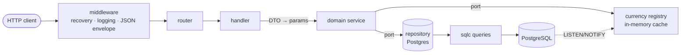

# Architecture

The service uses a **hexagonal (ports and adapters)** layout with
**manual constructor injection**: no DI framework.

- **Domain** packages (`internal/domain/...`) hold business types, rules,
  services and the *interfaces* (ports) they need, such as repositories and the
  currency registry. They do not import database or HTTP code.
- **Platform** packages (`internal/platform/...`) are adapters. They implement
  the domain ports on PostgreSQL and expose the services over HTTP.
- **Commands** (`cmd/...`) wire everything together and contain no business logic.



## Package layout

```
cmd/
  server/     HTTP API entry point: config, DB pool, wiring, graceful shutdown
  migrate/    `migrate up|down`: applies or reverts SQL migrations
  seed/       Loads currencies, account types and system accounts
internal/
  config/     Environment configuration (Load)
  domain/     Shared kernel: EntryType, ErrNotImplemented
    account/      Account domain: model, params, Repository port, Service
    transaction/  Transaction domain: model, params + Validate, Repository port, Service
    currency/     Currency codes, FormatMinor, Registry port
    withdrawal/   Withdrawal domain: model, params, Repository port, stub Service
  pagination/ Offset and cursor page envelopes
  platform/
    database/postgres/
      migrations/   SQL migrations (golang-migrate)
      query/        SQL source for sqlc
      sqlc/         Generated code (do not edit)
      repository/   Domain ports implemented on Postgres (+ CurrencyRegistry)
      seeder.go     Reference-data seeding
    idempotency/    Idempotency-Key Store port (Postgres adapter in repository/)
    transport/http/
      router.go, server.go   Routes and the http.Server
      handler/      HTTP handlers (one per endpoint)
      dto/          Request structs with validation tags
      httputil/     Request decoding and error → status mapping
      middleware/   Recovery, logging, JSON response envelope, Idempotency
      validation/   go-playground/validator setup and client-facing messages
docs/         This documentation
docker/       Development and production Dockerfiles and compose files
```

## Request flow

Take `POST /api/v1/transactions` as an example:

1. **Middleware** ([server.go](../internal/platform/transport/http/server.go)),
   outermost first: `Recovery` turns panics into a 500 and logs the stack,
   `Logging` writes one `http request` record (method, path, status, duration),
   and `JSONResponse` buffers the handler's output
   and wraps it in the [standard envelope](api.md#response-envelope).
2. **Router** ([router.go](../internal/platform/transport/http/router.go)) mounts
   `/health/` and `/api/v1/` using Go 1.22+ method patterns (`POST /transactions`).
   The POST routes that move money are wrapped in `middleware.Idempotency`,
   which runs inside `JSONResponse`: with an `Idempotency-Key` header it
   claims the key in `idempotency_records`, then either replays a saved
   response or runs the handler and saves its unwrapped output (see
   [API → Idempotency-Key](api.md#idempotency-key-header)).
3. **Handler** ([handler/](../internal/platform/transport/http/handler/))
   decodes the request with `httputil.DecodeAndValidate`, choosing which parts
   of the request to read (`SourcePath`, `SourceQuery`, `SourceBody`). It then
   validates the DTO and converts it with `ToDomainParams()`.
4. **Service** (`transaction.Service`) enforces domain rules: double-entry
   balance and an active currency.
5. **Repository** (`transactionRepository.Create`) writes the transaction and
   bulk-inserts its entries with `COPY` inside one database transaction.
6. **Database triggers** check again that the transaction balances and that the
   currencies match.
7. **Errors** at any layer go to the handler's `fail`, which calls
   `httputil.Error` to map known domain errors to status codes (see
   [API → Errors](api.md#errors)). Unknown errors become a generic 500 for the
   client, and `fail` logs the real cause.

## Wiring

All dependencies are built explicitly in
[cmd/server/main.go](../cmd/server/main.go) `run()`:

```
config.Load → logger.New (+ slog.SetDefault)
           → pgxpool + Ping → sqlc.Queries
           → repository.NewCurrencyRegistry(…, log)  (loads cache, starts LISTEN goroutine)
           → repository.NewAccountRepository / NewTransactionRepository
           → account.NewAccountService(…, log) / transaction.NewTransactionService
           → withdrawal.NewWithdrawalService()  (stub, no repository yet)
           → handler.NewHandler(handler.Services{…}, log) / NewHealthCheckHandler
           → repository.NewIdempotencyStore → middleware.Idempotency(store, cfg.IdempotencyTTL, log)
             (+ purgeIdempotencyRecords goroutine: DeleteExpired every hour)
           → httptransport.NewRouter(…, idempotent) → httptransport.NewServer(…, log)
```

`main` builds the logger and closes it only after logging `run`'s final error,
so file outputs receive it. `cmd/migrate` and `cmd/seed` follow the same
pattern; `migrate` validates its command before loading anything and exits
with code 2 on a usage error.

Shutdown is triggered by SIGINT or SIGTERM. The server stops accepting
connections and waits up to 30 s for in-flight requests. Cancelling the root
context also stops the currency registry's listener and the idempotency purge loop.

## Conventions

- **Money** is always an `int64` count of **minor units** (kobo, cents). Major
  units are only produced for display, as exact decimal strings, via
  `currency.FormatMinor`. Floats are never used.
- **IDs** are UUIDv7 (`uuidv7()` in Postgres 18), so they sort by creation time.
- **Errors**: each domain declares sentinel errors (`account.ErrAccountNotFound`,
  `transaction.ErrUnbalancedTransaction`, …). Repositories translate database
  errors into them, for example "no rows" becomes not-found and a unique
  violation becomes "already exists". The HTTP layer maps them with `errors.Is`, so
  wrapping with `%w` is safe.
- **Unimplemented operations** return `domain.ErrNotImplemented`, which the API maps to
  `501`. They never return `nil, nil`, which would look like success.
- **Configuration** comes only from environment variables (12-factor). A local
  `.env` is loaded if present.
- **Logging**: one `*slog.Logger`, built by
  [`logger.New`](../internal/logger/logger.go) from configuration, is passed to
  every component through its constructor (the last parameter, never nil; tests
  pass `slog.New(slog.DiscardHandler)`). Don't call the package-level
  `slog.Info`/`slog.Error` functions in application code. `slog.SetDefault` is
  set as well, but only as a safety net for third-party code. Components add
  context with `log.With`, e.g. the currency registry tags records
  `component=currency_registry`. Every record carries `service`. Outputs and
  formats are configured per environment; see
  [Getting started → Logging](getting-started.md#logging).
- **Lint**: `golangci-lint` with the config in [.golangci.yml](../.golangci.yml).
  It includes `integration`-tagged files.
