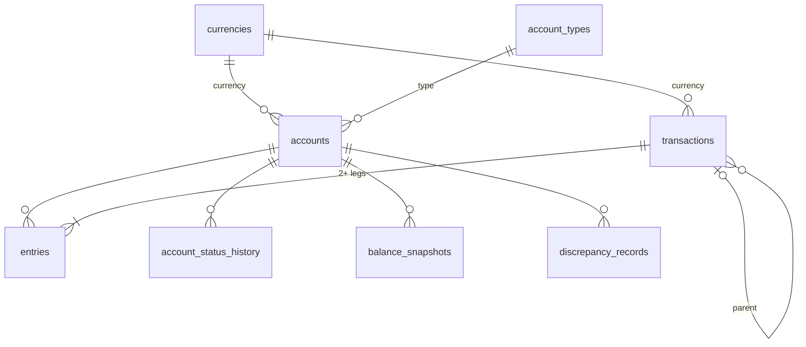

# Database

PostgreSQL **18** (the schema uses `uuidv7()`), accessed through `pgx/v5`
with queries generated by **sqlc**.

## Schema



| Table | Purpose | Key constraints |
|---|---|---|
| `currencies` | Supported currencies | PK `code`; `exponent`; `is_active` |
| `account_types` | Chart of accounts | PK `type`; `nature` ∈ ASSET/LIABILITY/REVENUE/EXPENSE/EQUITY; `normal_balance` (`entry_type`) |
| `accounts` | Ledger accounts | FK type → `account_types`, currency → `currencies`; `status` (`account_status`); **unique (owner_id, type, currency)** |
| `transactions` | Transaction headers | **unique `reference`**; optional self-FK `parent_transaction_id`; `metadata JSONB NOT NULL` |
| `entries` | Debit/credit legs | `amount > 0`; `entry_sequence BIGSERIAL` (global order) |
| `account_status_history` | Status change audit | actor ∈ SYSTEM/ADMIN; previous ≠ new; one `NULL` previous per account |
| `balance_snapshots` | Balance checkpoints | **unique (account_id, last_entry_sequence)** |
| `discrepancy_records` | Failed reconciliations | `resolved_at`/`resolution_notes` nullable until resolved |
| `idempotency_records` | [`Idempotency-Key`](api.md#idempotency-key-header) records: request fingerprint, status (`IN_PROGRESS`, `COMPLETED`, `FAILED`), saved response (JSONB: `{message, body}`) and expiry | Used by `repository.NewIdempotencyStore`. Claims are single statements (`INSERT … ON CONFLICT DO NOTHING`, then `ReclaimIdempotencyRecord` for an expired key or a FAILED one with the same fingerprint), so concurrent claims can't both win. Expired rows are deleted hourly |

Every foreign key is `ON DELETE RESTRICT`. Types: the `entry_type` enum is
`DEBIT` or `CREDIT`, and `account_status` is a `VARCHAR(32)` domain with a CHECK
on its five values.

## Triggers

| Trigger | On | Effect |
|---|---|---|
| `trg_enforce_entries_immutability` | `entries` UPDATE/DELETE | Raises an exception |
| `trg_enforce_transactions_immutability` | `transactions` UPDATE/DELETE | Raises an exception |
| `trg_enforce_account_status_history_immutability` | `account_status_history` UPDATE/DELETE | Raises an exception |
| `trg_check_transaction_integrity` | `entries` INSERT (per statement) | Rejects entries whose account currency ≠ transaction currency (SQLSTATE `LD001`), or any transaction whose entries don't sum to zero (`LD002`). The repository maps both codes to 422 errors; keep them in step with `repository/errors.go` |
| `trg_currency_updated` | `currencies` INSERT/UPDATE/DELETE | `pg_notify('currency_updated', code)` for the [registry](domains/currency.md#registry) |

Because of immutability, test data and mistakes stay in the database. Use a
dedicated database for integration tests; see [Testing](testing.md).

## Indexes

Beyond primary keys and unique constraints:

- `entries (account_id, entry_sequence) INCLUDE (type, amount)`: a covering index for
  balance and statement sums; also on `account_id` and `transaction_id`.
- `transactions (currency, created_at DESC)`, `parent_transaction_id` (partial),
  `metadata` (GIN).
- `uq_transactions_one_reversal`: **unique** `transactions (parent_transaction_id) WHERE type = 'REVERSAL'`,
  so a transaction has at most one reversal. The repository matches its name to return `ErrAlreadyReversed`;
  renaming it means updating `uniqueOneReversal` in `repository/errors.go`.
- `balance_snapshots (account_id, last_entry_sequence DESC)`: latest snapshot lookup.
- `idempotency_records (expires_at)` and a partial index on `IN_PROGRESS`.

## Balance sign convention

Every balance-producing query uses the **normal-balance** sign rule:

```sql
CASE WHEN e.type = account_types.normal_balance THEN e.amount ELSE -e.amount END
```

So a balance is positive in the account's natural direction: credit-normal
liabilities and revenue (wallets, payables, fees) and debit-normal assets
(cash) all read positive when funded. This rule is used by:

| Query | File |
|---|---|
| `GetAccountBalance` | `query/accounts.sql` |
| `GetAccountStatementSummary` (opening, closing) | `query/accounts.sql` |
| `ListAccountStatementEntries` (running balance) | `query/accounts.sql` |
| `ReconcileAccount` | `query/accounts.sql` |
| `CreateBalanceSnapshot` | `query/balance_snapshot.sql` |

Snapshots store balances with this sign, so *snapshot + delta* is always
consistent. **Any new query that produces a balance must use the same CASE**,
or reconciliation will report false discrepancies. The integrity trigger only
checks that debits equal credits, which doesn't depend on the convention.
The convention is pinned by the integration test.

## Migrations and sqlc

```
internal/platform/database/postgres/
  migrations/   NNNN_name.up.sql / .down.sql   (golang-migrate)
  query/        *.sql with `-- name: Foo :one|:many|:exec|:copyfrom`
  sqlc/         generated: models.go, querier.go, *.sql.go   — do not edit
sqlc.yaml       schema = migrations/, queries = query/
```

**Changing the schema (development phase):** edit the existing migration files
in place, keeping each `.up.sql` and `.down.sql` in step. Then:

```sh
make sqlc                                          # regenerate Go code
make docker-compose-down && make docker-compose-up # rebuild the dev DB
TEST_DATABASE_URL=… make test-integration           # includes up → down → up check
```

**Adding a query:** add it to `query/*.sql`. Every statement needs its own
`-- name:` header. A block without one is silently appended to the query above
it, which makes that query two statements and pgx rejects it. Run `make sqlc`,
then call the generated method from a repository and map rows to domain types
in [mapper.go](../internal/platform/database/postgres/repository/mapper.go).

Type mapping (`sqlc.yaml`): `uuid` becomes `uuid.UUID`, nullable `uuid` becomes
`uuid.NullUUID`, `timestamptz` becomes `time.Time`, `account_status` becomes `string`
(`*string` if nullable). Other nullable columns use `pgtype.*`. Keep those types
in the repository layer, out of domain structs.

### Scaffolded queries

Generated but not yet called by a repository. Each belongs to a [todo.md](todo.md) item.

| Query | File | Item |
|---|---|---|
| `ListAccountIDsAfter` | `query/accounts.sql` | later-reconcile-all |

There are no withdrawal queries: the `withdrawals` table is still commented
out in the core migration, and sqlc validates every query against the schema.

## Repository conventions

- "No rows" from a single-row lookup becomes the domain's not-found error via
  `notFound(err, account.ErrAccountNotFound)`.
- A unique violation (`23505`) becomes the domain's "exists" error
  (`ErrAccountExists`, `ErrDuplicateReference`, `ErrSnapshotExists`).
- Multi-statement writes run in `pool.Begin`, with
  `defer func() { _ = tx.Rollback(ctx) }()` (a no-op after commit).
- Account-level critical sections (reconcile, status change) lock the row with
  `GetAccountForUpdate` (`SELECT … FOR UPDATE`).
- `int` values passed to `int32` query parameters go through `toInt32`, which
  rejects out-of-range values instead of wrapping.
- **Listings** return "up to `limit` rows"; the service asks for one extra to
  set `has_more` ([pagination](domains/shared.md#internalpagination)). Cursor
  listings are keyset queries ordered by a unique key (`id DESC`, which is
  UUIDv7 and so creation order; `(created_at, id)` for status history; `entry_sequence` for
  statement entries). `ListAccounts` is the one offset listing; `CountAccounts`
  repeats its filters for `total_count`, and its `ORDER BY` always ends with `id` for stable pages.
